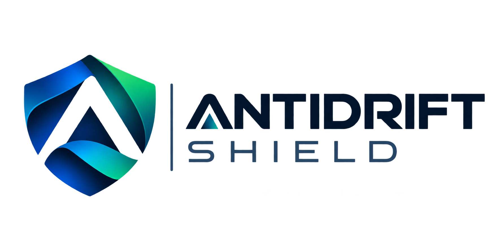

<div align="center">



# Anti-Drift Shield

**Stop AI coding agents from lying about what they built.**

[](https://www.npmjs.com/package/antidrift)
[](https://www.npmjs.com/package/antidrift)
[](LICENSE)
[](https://nodejs.org)
[](https://github.com/adorbis/antidrift)

[Install](#install) · [Quick Start](#quick-start) · [CLI Reference](#cli-reference) · [Config](#configuration) · [FAQ](#faq)

</div>

---

## The problem

You ask Claude Code, Cursor, or Antigravity to build a feature. It says:

> *"Done — I've created the auth component and wired it into the app."*

You check. The file exists. You trust it. You commit. You move on.

Three weeks later at merge time, you discover:

- The file was **never imported anywhere** (orphaned)
- Half its functions are `// TODO` stubs
- The "wired" claim was a **hallucination**

You spend a week untangling. Multiply by every AI session across the project. **That's months of your life.**

This is **AI drift**. It's silent, expensive, and universal.

---

## The solution

`shield` is a verification engine that sits between your AI agent and `git commit`. It **physically verifies every claim** against your codebase.

| Check | What it catches |
|-------|----------------|
| **Orphans** | Files created on disk, never imported anywhere |
| **Stubs** | `// TODO`, `// FIXME`, `throw new Error("Not implemented")` |
| **Type errors** | `tsc --noEmit` failures |
| **Worktrees** | Detached HEADs, uncommitted junk |
| **Package drift** | Unrequested `package.json` / lockfile changes |
| **False claims** | "I built X" / "X is wired" verified against reality |
| **Repeated claims** | Same lie told twice without progress |

If any check fails, `shield verify` **blocks the commit**.

---

## Quick demo

```bash
$ shield goal "Add user profile settings page"
[SHIELD: GOAL SET]  ID: add-user-profile-settings-page

$ shield claim "I built the ProfileSettings component"
$ shield claim "ProfileSettings is wired into the app"

$ shield verify

[ORPHANED FILES — never imported anywhere]
  ✗ src/components/ProfileSettings.tsx

[STUBS DETECTED — TODO / FIXME / Not-implemented]
  ✗ src/components/ProfileSettings.tsx

[CLAIMS VERIFIED]
  ✓ VERIFIED "I built the ProfileSettings component"
  ✗ FALSE     "ProfileSettings is wired into the app"

[STATUS: DRIFT DETECTED]
Fix the above before committing.
```

---

## Install

**Requires Node.js 18+** — [download here](https://nodejs.org)

### Any platform (npm)

```bash
npm install -g antidrift
```

Provides two binaries: `shield` and `antidrift`.

### macOS (Homebrew)

```bash
brew install adorbis/tap/antidrift
```

### Windows (Scoop)

```powershell
scoop bucket add adorbis https://github.com/adorbis/scoop-bucket
scoop install antidrift
```

### Verify install

```bash
shield --version
```

---

## Quick start

```bash
cd your-project
shield init
shield goal "What you're building"
shield claim "<what the agent claimed>"
shield verify
shield complete
```

Every `git commit` from now on is verified.

---

## CLI reference

| Command | Description |
|---|---|
| `shield init` | Install pre-commit hook + inject AI guardrails + create config |
| `shield goal "<text>"` | Set the active objective |
| `shield claim "<text>"` | Register a claim the AI made |
| `shield verify` | Full audit: orphans, stubs, types, worktrees, packages, claims |
| `shield complete` | Re-verify, then archive the milestone |
| `shield list` | Show all objectives |
| `shield switch <id>` | Switch between parallel objectives |
| `shield inject-rules` | Re-inject guardrails into AI client rule files |
